# Architecture of the `classes` Library

The `classes` package is a small reusable library that implements FAQ search and
Retrieval-Augmented Generation (RAG) over the DataTalks.Club FAQ corpus, plus an
agentic tool-calling stack. It is consumed by the scripts in `module_1/` and
`module_2/`, which are the course exercises; `classes/` is the reusable part.

This document records the **design patterns** used in the code and the **design
decisions** behind them, together with a component reference so that the
library can be navigated without reading every module.

---

## Layering at a glance

The package follows a ports-and-adapters (hexagonal) arrangement with three
concentric layers. Dependencies point inwards only.

```mermaid
flowchart TD
    subgraph app["Application / orchestration"]
        RAG["RAGPipeline"]
        AG["Agent"]
        FSF["FAQSearcherFactory"]
        FSX["FAQSearcher"]
        PB["PromptBuilder"]
        TH["Thread"]
        TS["Toolset"]
        LP["LLMPrompter"]
    end

    subgraph domain["Domain ports (vocabulary)"]
        FAQ["FAQ - ABC"]
        KI["KeywordIndex - ABC"]
        VI["VectorIndex - ABC"]
        EM["Embedder - ABC"]
        LI["LLMInstruction - Protocol"]
    end

    subgraph adapters["Adapters / infrastructure"]
        LEX["LexicalFAQ"]
        SEM["SemanticalFAQ"]
        IMI["InMemoryIndex - minsearch"]
        IMV["InMemoryVectorIndex - minsearch"]
        LDB["LocalDbIndex - SQLite"]
        LVDB["LocalVectorDbIndex - SQLite"]
        PGV["PgvectorIndex - PostgreSQL"]
        SE["SentenceEmbedder - sentence-transformers"]
        RF["RawFaq - HTTP"]
    end

    subgraph cross["Cross-cutting"]
        MR["ManagedResource - lifecycle mixin"]
        SC["SearcherConfig"]
    end

    RAG --> FSF
    RAG --> FSX
    RAG --> PB
    RAG --> LP
    AG --> LP
    AG --> TS
    PB --> TH
    TH --> LI

    FSX --> FAQ
    FSF --> FAQ
    FSF --> SC

    LEX --> KI
    SEM --> VI
    SEM --> EM
    LEX --> RF
    SEM --> RF

    IMI --> KI
    LDB --> KI
    IMV --> VI
    LVDB --> VI
    PGV --> VI
    SE --> EM

    IMI -.-> MR
    LDB -.-> MR
    IMV -.-> MR
    LVDB -.-> MR
    PGV -.-> MR
```



Reading rule: a module may only depend on the layer above it. `SemanticalFAQ`
knows the `VectorIndex` and `Embedder` vocabularies but never `psycopg`;
`PgvectorIndex` knows SQL but never the FAQ corpus.

---

# Design patterns

## 1. Ports and adapters (hexagonal architecture)

This is the dominant pattern; the more specific GoF patterns below are local
applications of it.

**Ports** (defined in the domain vocabulary, no technology named):

| Port | File | Purpose |
|------|------|---------|
| `FAQ` | `classes/faq.py` | The retrieval contract the orchestration layer talks to |
| `KeywordIndex` | `classes/keyword_index.py` | Lexical store contract |
| `VectorIndex` | `classes/vector_index.py` | Vector store contract |
| `Embedder` | `classes/embedder.py` | Text-to-vector contract |
| `LLMInstruction` | `classes/llm_instructions.py` | System-instruction contract (a `Protocol`) |

**Adapters** (implement a port, own a technology):

| Adapter | Implements | Technology owned |
|---------|-----------|------------------|
| `LexicalFAQ` | `FAQ` | none (delegates to a `KeywordIndex`) |
| `SemanticalFAQ` | `FAQ` | none (delegates to a `VectorIndex` + `Embedder`) |
| `InMemoryIndex` | `KeywordIndex` | `minsearch.Index` |
| `InMemoryVectorIndex` | `VectorIndex` | `minsearch.VectorSearch` |
| `LocalDbIndex` | `KeywordIndex` | `sqlitesearch.TextSearchIndex` (SQLite) |
| `LocalVectorDbIndex` | `VectorIndex` | `sqlitesearch.VectorSearchIndex` (SQLite) |
| `PgvectorIndex` | `VectorIndex` | `psycopg` + PostgreSQL/pgvector |
| `SentenceEmbedder` | `Embedder` | `sentence-transformers` |
| `RawFaq` | — (source) | `requests` over the DataTalks.Club FAQ endpoints |

The payoff is the *substitution axis*: the number of `FAQ` implementations stays
at two (lexical, semantic) while the number of concrete stores grows
independently. Adding a fourth store (e.g. Qdrant, Elasticsearch) requires one
new `VectorIndex` and one registry entry, and touches nothing else.

## 2. Abstract base class and template method

All four ports — `FAQ`, `KeywordIndex`, `VectorIndex` and `Embedder` — are
`abc.ABC` with `@abstractmethod` members, so the contract is enforced at
instantiation time:

```
FAQ.__abstractmethods__          -> {'open', 'search', 'close', 'build_index', 'count'}
KeywordIndex.__abstractmethods__ -> {'open', 'is_open', 'reset', 'load', 'search', 'size', 'close'}
VectorIndex.__abstractmethods__  -> {'open', 'is_open', 'reset', 'load', 'search', 'size', 'close'}
Embedder.__abstractmethods__     -> {'embed_texts', 'encode_text', 'embedding_dimension'}
```

The template method is most visible in the two FAQ adapters. `build_index()`
fixes an invariant skeleton and lets the abstract members supply the varying
steps:

```
SemanticalFAQ.build_index():          LexicalFAQ.build_index():
  fetch corpus (RawFaq)                  fetch corpus (RawFaq)
  abort if empty                         abort if empty
  embed every document                   --
  validate count + dimension             --
  open()                                 open()
  reset()                                reset()
  load(documents, vectors)               load(documents)
```

Both adapters implement the same algorithm with the same ordering, so the
"rebuild is atomic" guarantee is implemented once per family rather than per
store.

> Every member of every port is abstract, properties included: `FAQ.count` and
> `Embedder.embedding_dimension` use the `@property` over `@abstractmethod`
> order, the same convention as `KeywordIndex.is_open` and `VectorIndex.is_open`.
> The reverse order raises `AttributeError` at class creation, because `property`
> objects do not accept the `__isabstractmethod__` attribute.

## 3. Adapter

The Adapter pattern appears at three levels.

- **`SemanticalFAQ` adapts `(VectorIndex, Embedder)` to `FAQ`.** It owns the
  translation between vocabularies: it encodes the question with the embedder,
  maps the store's result rows back to the FAQ document shape, and re-expresses
  the store's `open/reset/load/size` in the FAQ lifecycle
  (`open/close/build_index/count`). Every technology-specific import
  (`psycopg`, `numpy`) lives *below* it, in the store.
- **`LexicalFAQ` adapts `KeywordIndex` to `FAQ`**, doing the same job for the
  lexical family.
- **`LLMPrompter._process_output` adapts the OpenAI SDK output items** to the
  library's own dataclasses (`MessageResponse`, `FunctionCallResponse`), so the
  SDK types never appear above the prompter boundary.

`PromptBuilder` is a third kind of adapter: it adapts a list of retrieved
documents into a prompt string.

## 4. Strategy

- **`Embedder` is the strategy for turning text into vectors.** `SentenceEmbedder`
  is the concrete strategy; `SemanticalFAQ` depends on the abstraction and can be
  given any embedder (a stub in tests, another model in production).
- **The choice of lexical versus semantic retrieval is itself a strategy**
  resolved at runtime by `FAQSearcherFactory` from a `SearcherConfig`. The
  orchestration code (`RAGPipeline`) is identical for both.

## 5. Factory and provider registry

`FAQSearcherFactory` (`classes/faq_searcher_factory.py`) maps a
`SearcherConfig` to a concrete `FAQ` and wraps it in a `FAQSearcher`.

The mapping is a flat registry keyed by the tuple `(index_type, vector_engine)`:

| Key | Provider | Builds |
|-----|----------|--------|
| `("in_memory", None)` | `_in_memory_lexical` | `LexicalFAQ(InMemoryIndex())` |
| `("in_memory", "sentence")` | `_in_memory_semantic` | `SemanticalFAQ(InMemoryVectorIndex(), embedder)` |
| `("local", None)` | `_local_lexical` | `LexicalFAQ(LocalDbIndex(path))` |
| `("local", "sentence")` | `_local_semantic` | `SemanticalFAQ(LocalVectorDbIndex(path), embedder)` |
| `("repository", "sentence")` | `_repository_semantic` | `SemanticalFAQ(PgvectorIndex(dsn, dimension), embedder)` |

`("repository", None)` is deliberately **not** registered: a relational store
without an embedding model has no meaning. Any unregistered pair raises
`ValueError("Unknown index type/vector engine: ...")`.

Two properties of the registry are worth calling out:

- **Each provider owns its own imports.** The import statements live inside the
  provider functions, so importing the factory does not import `torch`,
  `sentence-transformers` or `psycopg`. This keeps the import graph of a
  keyword-only run free of heavy dependencies.
- **The factory contains no `match`/`if` on the config dimensions.** Adding a
  backend is one registry entry; changing the selection logic is one dict
  lookup. (This replaced an earlier design with nested `match` statements, which
  degraded structurally as backends multiplied — see the "Redesign of
  `FAQSearcherFactory`" note in the repository history.)

## 6. Dependency injection

Every collaborator is supplied through the constructor; no component reaches for
a global or builds its own heavy dependency:

```
RAGPipeline(searcher: FAQSearcher, prompt_builder: PromptBuilder, llm_prompter: LLMPrompter)
Agent(prompter: LLMPrompter, thread: Thread)
SemanticalFAQ(index: VectorIndex, embedder: Embedder)
LexicalFAQ(index: KeywordIndex)
PromptBuilder(thread: Thread)
Thread(llm_instruction: LLMInstruction)
PgvectorIndex(dsn: str, *, dimension: int)
```

Two explicit seams exist for substitution:

- `FAQSearcherFactory(embedder=...)` and `FAQSearcherFactory.create(config, embedder=...)`
  accept an embedder, so the expensive model can be shared across searchers or
  replaced by a fake.
- `PgvectorIndex` requires the DSN as an argument and never reads the
  environment, so the caller decides where configuration comes from.

## 7. Builder

- **`PromptBuilder`** assembles the user prompt: it renders the retrieved
  documents into a context block, formats it with `utils.build_prompt`, appends
  the result to the shared `Thread`, and returns that thread for the next step.
- **`Thread` is a builder for the OpenAI Responses API input.** Instead of
  assembling the `list[ResponseInputItemParam]` by hand, callers use small
  additive methods: `add_user_message`, `add_assistant_text`,
  `add_function_call`, `add_function_call_output`. `get_input()` returns a copy,
  so the builder cannot be mutated from the outside.
- **`Toolset` is a builder for the tool catalogue.** `add(definition, callback)`
  appends an `AgentTool`; `get_definitions()` and `get_callbacks()` derive the two
  views the rest of the stack needs.

## 8. Facade

- **`FAQSearcher`** is a simplifying facade over `FAQ`: it wraps the port and
  pins the default `course="llm-zoomcamp"` filter, so the pipeline never spells
  out `filter_dict={"course": ...}`.
- **`RAGPipeline`** is a facade over three collaborators (retrieval, prompt
  building, generation), exposing a single `answer(question)` call.

## 9. Mixin for a cross-cutting concern

`ManagedResource[_T]` (`classes/managed_resource.py`) is a generic mixin that
centralises the resource lifecycle shared by every concrete index:

```python
class InMemoryIndex(ManagedResource[Index], KeywordIndex): ...
class LocalDbIndex(ManagedResource[TextSearchIndex], KeywordIndex): ...
class PgvectorIndex(ManagedResource[Connection[dict[str, Any]]], VectorIndex): ...
```

The mixin provides:

- `_register_resource(resource, closer)` — stores the resource and registers the
  closer with a `weakref.finalize`.
- `_require_resource()` — returns the resource or raises
  `RuntimeError(self.closed_message)`.
- `_release_resource()` — drops the reference and detaches the finalizer.
- `is_open` — the lifecycle state as a queryable property.
- `__enter__` / `__exit__` — context-manager support, closing on exit.

The mixin is placed **before** the ABC in the bases so that its concrete
`is_open` property shadows the abstract one declared by `KeywordIndex` /
`VectorIndex`. The resulting MRO is:

```
InMemoryIndex -> ManagedResource -> Generic -> KeywordIndex -> ABC -> object
```

This is an implicit coupling: it works only because the mixin precedes the port.
The same mixin also provides the `closed_message` attribute, which every
concrete index re-declares with its own wording.

## 10. Guard clause / lifecycle state check

Use-while-closed is detected by an explicit guard, not by probing:

```python
def _require_resource(self) -> _T:
    resource = self._resource
    if resource is None:
        raise RuntimeError(self.closed_message)
    return resource
```

This replaces the older idiom of probing the store with `count()`, which had two
problems: it forced a round-trip to the database on every state check, and it
made it impossible to open a store whose table does not exist yet (which is
exactly the state a freshly created pgvector database is in, before the first
`build_index()`).

## 11. Finalizer (resource safety)

`ManagedResource` registers a `weakref.finalize` with the resource's closer, so
an external resource (a SQLite connection, a PostgreSQL connection) is closed
even if `close()` is never called. The finalizer is detached explicitly on
release, which prevents the "the finalizer was overwritten and the previous
connection leaked" bug.

For the volatile in-memory stores there is no `close()` in the underlying
library, so a custom closer that clears the heavy buffers is registered
instead:

```python
def _clear_index(index: Index) -> None:
    index.docs = []
    index.text_matrices = {}
    ...
```

The docstrings name the cause explicitly ("this smell is caused by the lack of
explicit memory cleaning in `minsearch.Index`"), i.e. the adapter absorbs a
third-party defect instead of leaking it to callers.

## 12. Protocol (structural typing)

`LLMInstruction` (`classes/llm_instructions.py`) is a `typing.Protocol`, not an
ABC:

```python
class LLMInstruction(Protocol):
    prompt: EasyInputMessageParam
    message: str
```

`PipelineLLMInstruction` and `SearchAgentLLMInstruction` satisfy it
structurally. A new system prompt therefore needs no base class and no
inheritance chain — only two attributes.

## 13. Value objects and data transfer objects

Immutable-ish dataclasses carry data across boundaries with no behaviour:

- `SearcherConfig` — the declarative request (what backend, which engine).
- `MessageResponse`, `FunctionCallResponse`, `AgentResponse` — the parsed model
  output.
- `AgentTool` — the (definition, callback) pair held by `Toolset`.

## 14. Discriminated union and type-based dispatch

The model output is modelled as a small union rather than as raw SDK items:

```python
AgentResponse.data: list[MessageResponse | FunctionCallResponse]
```

Each member carries a literal `type` discriminator (`"message"` /
`"function_call"`). Both the prompter and the agent dispatch on it with
`match`/`case`:

```python
match item:
    case i if type(i) is MessageResponse: ...
    case i if type(i) is FunctionCallResponse: ...
    case _: pass
```

Consequences: SDK types stay behind the prompter boundary, the agent loop reads
as a state machine over its own vocabulary, and `mypy` can check the union.

## 15. Command and registry-based dispatch

Each entry in a `Toolset` pairs a declarative definition
(`FunctionToolParam`, sent to the model) with an executable callback
(`Callable[[Any], Any]`, run by the agent). The `Agent` obtains a
`name -> callback` map and dispatches with `callbacks[item.name](**item.arguments)`.

The tool callback is effectively a Command: it is a first-class object stored in
an aggregate, executed later by a different component, with its metadata
(the definition) kept separate from its behaviour (the callable).

## 16. Lazy loading

- **`RawFaq.items` is a property**, so constructing the object is free and the
  network fetch happens only when an index build needs the data.
- **`SentenceEmbedder.embedding_dimension` probes the model once**
  (`encode_text("probe")`) and caches the result.
- **Provider functions import their concrete classes inside the function body**,
  keeping torch and psycopg out of the import graph until they are needed.
- **`SentenceTransformer` is loaded from a local directory**, never from the Hub
  (see the offline decision below).

## 17. Registry

`_PROVIDER_REGISTRY` is a module-level dictionary acting as a catalogue of
supported backends. It is the single place that states which combinations are
legal, and it is the extension point for new backends.

---

# Design decisions

## 1. One `FAQ` port over two storage strategies

The orchestration layer (`RAGPipeline`, `Agent` tooling) depends only on `FAQ`.
`LexicalFAQ` and `SemanticalFAQ` are interchangeable implementations of that
port. This keeps retrieval swappable (keyword vs vector) without touching the
pipeline, the prompt builder or the LLM client.

## 2. Two ports, not one: `KeywordIndex` and `VectorIndex`

The two families are deliberately **not** merged into a single `SearchIndex`.
They differ in more than the storage technology:

- a vector index needs embeddings on input (`load(documents, vectors)`) and a
  query vector on search, while a keyword index needs only text;
- only the keyword family supports `boost_dict` (field boosting);
- only the vector family has a meaningful embedding dimension.

Splitting the ports keeps each contract minimal and honest. The unification is
achieved one level up, in the `FAQ` adapters.

## 3. A single document shape: `list[dict[str, str]]`

Every store returns the *same* shape as the raw FAQ items
(`course`, `section`, `question`, `answer`), so the prompt builder can render
the results without knowing where they came from. This was an explicit change:
the vector port previously returned a `SearchResult` dataclass
(`document`, `distance`, `rank`), and it was dropped so that the vector and
keyword results are interchangeable for the prompt builder.

The cost is that stores return their own extra columns inside the same
dictionary: the SQLite stores add an `id`, and the pgvector store adds the
`distance` (a `float`). The declared type `list[dict[str, str]]` is therefore
a simplification that the concrete stores do not fully honour, and it is the
reason the prompt builder reads only the three fields it needs
(`section`, `question`, `answer`) instead of iterating over the mapping.

## 4. `build_index()` means *rebuild*, and it is atomic

`build_index()` never appends. It replaces the whole corpus:

- the volatile in-memory stores create a brand-new index object;
- the persistent stores call `reset()` (drop/recreate the schema, or clear the
  SQLite tables) and then `load()`.

The ordering is deliberate and is the core safety property of the method:

> **fetch and validate everything first, destroy only afterwards.**

Concretely, the adapters fetch the corpus, abort if it is empty, embed it (for
the semantic adapter), validate that the number of embeddings matches the number
of documents and that the dimension matches the declared one, and only then call
`reset()` and `load()`. A failed download or a failed embedding therefore leaves
the previous index fully intact and usable.

This is stated in the `FAQ` contract itself
(`classes/faq.py`: *"Implementations must keep the previous content untouched
when the new content cannot be fetched or embedded"*) and is asserted by the
test suite for both adapters and for all three persistent backends.

A practical consequence: running an ingestion twice yields the same document
count, and a brand-new database needs no prior setup step.

## 5. Lifecycle ownership in one place

Every concrete index is a `ManagedResource`. The pattern is uniform:

- `open()` is idempotent-safe: it closes the previously held resource first,
  then registers the new one;
- `close()` is idempotent: closing twice is a no-op;
- `__exit__` closes, so the indexes work as context managers;
- a `weakref.finalize` is the safety net when `close()` is forgotten.

The mixin distinguishes *releasing* from *closing*: `_release_resource()`
detaches the finalizer without invoking it. Every concrete `open()` therefore
starts with `if self.is_open: self.close()`, so the previous resource is
genuinely closed rather than merely forgotten. The behaviour is covered by
tests, but the contract lives in the mixin while the obligation lives in each
subclass.

## 6. `is_open` as a state query instead of probing

`VectorIndex` and `KeywordIndex` expose `is_open` as a property. The adapters
ask `if not self._index.is_open: self._index.open()` instead of trying the
store and interpreting the failure. Two benefits: no round-trip to the database
to answer a lifecycle question, and a store whose table does not exist yet is a
perfectly valid "open but empty" state — which is the state of a fresh
pgvector database before its first ingestion.

## 7. `reset()` is part of the contract even when it is a no-op

`reset()` appears in both ports, so the adapters can rebuild any store through
the same call sequence. For the volatile in-memory indexes it is an explicit
no-op with a documented rationale: `open()` already discards any previous
content by creating a brand-new empty index, so there is nothing to clear. The
method exists solely to honour the `KeywordIndex` / `VectorIndex` contract
invoked by `LexicalFAQ.build_index` / `SemanticalFAQ.build_index`.

This is a deliberate choice to keep the port uniform at the cost of a
documented empty method.

## 8. `extra_params`: an OpenAI-style escape hatch for backend-specific options

Field boosting exists only for lexical indexes, but the pipeline must be able to
call both families with one signature. The solution is an optional
`extra_params: dict[str, Any]` mapping, in the style of the OpenAI API:

```
RAGPipeline.answer()
  merged_extra = {"boost_dict": {...}}
  merged_extra.update(caller_extra_params)
      |
      v
FAQSearcher.search(question, course, extra_params, num_results)
      |  always forwards extra_params, always injects filter_dict={"course": ...}
      v
FAQ.search(question, filter_dict, num_results, extra_params)
      |
      +--> LexicalFAQ.search(): merges boost_dict into extra_params and
      |    splats it into KeywordIndex.search(...)
      |
      +--> SemanticalFAQ.search(): accepts extra_params and ignores it
```

`SemanticalFAQ` deliberately accepts and discards `extra_params` so that it is
not forced to declare a `boost_dict` parameter that has no meaning for vector
search. The consequence, accepted knowingly, is that **the boosts configured by
`RAGPipeline` are a no-op on the semantic backends** — the caller cannot tell
from the call site that boosting has no effect.

A second consequence of the splat: an unrecognised `extra_params` key reaches
`KeywordIndex.search()`, which has no `**kwargs`, and surfaces as a raw
`TypeError: ... got an unexpected keyword argument`. The escape hatch is
therefore only as wide as the destination signature.

## 9. Normalisation of optional search parameters at every boundary

`utils.normalize.normalize_index_param` is applied by every concrete index
before delegating to the underlying library. It drops `None` values, collapses
empty mappings to `None`, and returns a **new** dictionary so the caller's
mapping is never aliased by the store.

The reason is vendor-specific: `minsearch` and `sqlitesearch` treat a
`filter_dict={}` differently from `filter_dict=None`, and both choke on
`{"course": None}`. Normalising once, in one shared helper, keeps that
knowledge out of five index implementations.

## 10. Configuration-driven composition

`SearcherConfig` is a `Literal`-typed dataclass:

```python
index_type: Literal["in_memory", "local", "repository"]
vector_engine: Literal["sentence"] | None = None
local_index_path: str | None = None
database_url: str | None = None
```

The `Literal` types make the legal values discoverable by the type checker and
by the reader; the registry then validates the *combination*, and the provider
validates the presence of the required field (`"Local DB path must be provided"`,
`"Database URL must be provided"`). Adding a backend is: one provider, one
registry entry, one `Literal` value.

## 11. The factory performs the I/O, and the caller never sees the resource

`FAQSearcherFactory.create()` does more than construct: for `in_memory` it
calls `build_index()` (which downloads the corpus), for the persistent backends
it calls `open()`. This preserves the convenience of the original course
scripts, which expect an immediately usable searcher.

The trade-off is accepted but visible: the factory returns only the
`FAQSearcher`, so the underlying `FAQ` — and its connection — cannot be closed
through the returned object. The persistent-backends scripts therefore leave
the connection to the finalizer.

## 12. Embeddings are always local and always offline

`sentence-transformers` is configured for offline use at import time:

```python
os.environ.setdefault("TRANSFORMERS_OFFLINE", "1")
os.environ.setdefault("HF_HUB_OFFLINE", "1")
```

The flags must be set before `huggingface_hub` is imported, because that library
reads them once at import time; they are set with `setdefault` so an explicit
value from the environment wins. `local_model_path()` then searches
`SENTENCE_TRANSFORMERS_HOME` (including the legacy `<home>/<model-name>`
layout) and the Hub cache (`HF_HUB_CACHE` / `HF_HOME`), and returns the first
directory that actually contains `modules.json`. `load_transformer()` loads that
**directory**, not the model id, so the Hub resolution code path is never
executed and no download is ever attempted. If the model is absent, the failure
is an explicit `RuntimeError` telling the user how to fetch it once.

`SentenceEmbedder` also batches the work (`batch_size = 50`) with a `tqdm`
progress bar, so embedding ~1.4k documents is observable rather than silent.

## 13. A single pinned model, and the dimension is derived, not assumed

The library pins `sentence-transformers/all-MiniLM-L6-v2` (384 dimensions). The
dimension is not hard-coded in the store: the caller derives it from the
embedder and passes it explicitly:

```python
PgvectorIndex(dsn, dimension=embedder.embedding_dimension)
```

`PgvectorIndex` requires `dimension` with no default, so the store cannot
silently disagree with the model that feeds it. The DDL then creates the
column as `vector(<dimension>)` with the value injected through
`psycopg.sql.Literal`, never through string formatting.

The dimension check happens in two places: `SemanticalFAQ.open()` compares
`index.dimension` (when the index exposes one) with
`embedder.embedding_dimension`, and `build_index()` re-checks the shape of the
returned matrix against the declared dimension.

## 14. pgvector-specific choices

- **Cosine similarity**: the HNSW index is created with `vector_cosine_ops` and
  the search uses the `<=>` operator, ordering by distance in SQL. This matches
  the unit-normalised embeddings produced by MiniLM.
- **No pgvector Python adapter**: vectors are serialised as the text literal
  `[1.0,0.5,...]` and cast with `%s::vector`, which keeps the dependency set
  minimal (psycopg only).
- **Parameterised SQL**: every value is a bound parameter (`%s`); the only
  interpolated fragment is the `WHERE` clause, whose field names are validated
  against the `_INSERT_COLUMNS` allowlist before being placed in the statement.
- **One statement funnel**: `_execute()` translates the driver error
  `UndefinedTable` into the library's own vocabulary,
  `RuntimeError("The documents table does not exist yet. Build the index first.")`,
  so a search before the first ingestion fails with a library message rather
  than a raw `psycopg` error.
- **`zip(..., strict=True)`** in the bulk insert, so a length mismatch is an
  error rather than a silent truncation (the length is also checked explicitly
  beforehand with a dedicated `ValueError`).
- **The connection is closed and committed explicitly**: `reset()` and `load()`
  each commit at the end, so a rebuild is atomic from the client's point of view.

## 15. SQLite is the local store

Both local backends are plain SQLite files through `sqlitesearch`
(`TextSearchIndex` and `VectorSearchIndex` in `ivf` mode). This makes a local
RAG run reproducible with no server, and the file survives across processes, so
the corpus is embedded once and reused.

The stores are documented as *persistent but treated as read-only and
immutable*: content is replaced wholesale (`reset()` + `load()`) rather than
appended to. `LocalDbIndex.load` documents the underlying constraint that
`TextSearchIndex.fit` refuses to append to a non-empty index, which is exactly
why `reset()` precedes it.

## 16. Field configuration of the keyword stores

Both keyword stores are configured identically:

```python
text_fields=["question", "section", "answer"]
keyword_fields=["course"]
```

`course` is a keyword field because it is an exact-match filter, and it is the
filter that `FAQSearcher` always injects.

## 17. Default field boosts live in the pipeline

`RAGPipeline.answer` always seeds the search parameters with

```python
boost_dict = {"question": 2.0, "section": 1.0, "answer": 0.5}
```

and merges the caller's `extra_params` on top, so a caller can override a
boost. The defaults encode the intent that a question match is a stronger
signal than a section match, which is weaker than an answer match.

## 18. The Responses API, with server-side state disabled

The agent stack targets the OpenAI **Responses API** rather than Chat
Completions, and every call sets `store=False`. The consequence is that the
conversation state lives entirely in the library's `Thread`, which makes the
thread the single source of truth and makes the agent loop reproducible.

`Thread` stores typed SDK items (`EasyInputMessageParam`,
`ResponseFunctionToolCallParam`, `FunctionCallOutput`), so the payload sent to
the API is well-formed by construction instead of by hand.

## 19. The thread owns the conversation; the prompt builder fills it

`PromptBuilder.build()` renders the retrieved documents into a context block
(`section`, `Q:`, `A:` lines), formats it with `utils.build_prompt`, appends the
user message to the shared `Thread`, and returns that thread. `LLMPrompter`
then generates from `thread.get_input()` plus `thread.get_instruction()`.

Two consequences of this ownership model:

- the pipeline is stateless with respect to the conversation: the state lives in
  the injected `Thread`, so a caller can create a fresh thread per question or
  reuse one to accumulate history;
- `PromptBuilder.build` appends but never appends the assistant's answer, so
  reusing the same `Thread` for two questions sends both questions in a single
  request. Reuse requires adding the assistant turn explicitly.

## 20. A discriminated union at the prompter boundary

The prompter translates the SDK output into `AgentResponse`, whose payload is
`MessageResponse | FunctionCallResponse`. The rule is: *the SDK's vocabulary
stops at the prompter*. Everything above it (the agent loop, the tool dispatch)
works with the library's own types, matched on their `type` discriminator.

## 21. Termination rule of the agentic loop

`Agent.invoke` loops until a turn produces **no** function call. Each turn:

1. asks the model for the next response given the current thread and tools;
2. appends assistant messages to the thread;
3. for each function call, appends the call to the thread, executes the
   matching callback from the toolset, and appends the result as a
   `function_call_output`;
4. if no tool was called, joins the accumulated assistant texts and returns
   them as the final answer.

The rule is deliberately simple: the loop is bounded by the model's behaviour,
and the "no tool call in this turn" signal is the only exit condition. Tool
results are fed back through the same thread, so the model sees its own
tool calls in the next turn.

## 22. A tool is a definition plus a callback

`Toolset` stores `AgentTool(definition, callback)` pairs and derives two views:
the list of definitions sent to the API, and the `name -> callback` map used
for dispatch. Keeping the two together in one object means a tool cannot be
declared to the model without a way to execute it, and vice versa.

The definition is stored as a plain `dict` and cast to `FunctionToolParam`, so
a malformed definition is not detected at `add()` time but at dispatch time.

## 23. Instructions are structural, not nominal

`LLMInstruction` is a `Protocol`, so `PipelineLLMInstruction` (a
context-answering pipeline) and `SearchAgentLLMInstruction` (a tool-using
search assistant) are interchangeable without a shared base class. The
`prompt` member (a fully-formed system message) is kept for callers that need
the structured form, while `Thread` consumes only `message`.

## 24. Secrets and configuration: explicit for infrastructure, ambient for the LLM

- **`PgvectorIndex` never reads the environment.** The DSN is a required
  constructor argument; the caller resolves `DATABASE_URL` and passes it in.
  This keeps the store free of hidden dependencies and makes it trivial to test.
- **`LLMPrompter` reads `LLM_BASE_URL` and `LLM_API_KEY`** from the environment
  at construction, and `python-dotenv` is loaded at module import. This keeps
  the course scripts short, at the price of a global side effect at import time
  and of a component that cannot be pointed at a different endpoint without
  patching the environment.

## 25. Type-safety posture

`mypy` runs in strict mode over `classes/` and `utils/`. The library leans on
the type system in several places: `Literal` for the config axes, `NDArray` for
vectors (`Vector = NDArray[Any]`), `list[dict[str, str]]` for the document
shape, `Protocol` for the instruction, and a union for the model output.

The one place where this breaks down is the `FAQ` port itself:

```python
def search(self, *args: Any, **kwargs: Any) -> list[dict[str, str]]: ...
```

The port is deliberately untyped in its parameters, which means `mypy` cannot
verify that `FAQSearcher` calls the adapters with arguments they accept, nor
that the `extra_params` splat is safe. This is the root cause of the
`TypeError` described in decision 8.

`ruff` (lint + format) and `isort` enforce an 88-column style, and the
conventions require English docstrings in Google style (Args/Returns, no usage
examples).

## 26. Testing strategy

The suite is split into two tiers, which is itself a decision:

- **`tests/unit`** is offline and fast. It exercises the *real* implementations
  over real SQLite files in `tmp_path`, and fakes only the two genuinely
  external boundaries: the HTTP corpus (`StubRawFaq`, `ExplodingRawFaq`,
  `EmptyRawFaq`) and the PostgreSQL socket (`_FakeConnection` injected through
  `monkeypatch`). `unittest.mock` is not used anywhere; the doubles are
  hand-written and small.
- **`tests/integration`** downloads the real corpus once per session, embeds it
  with the cached model, and exercises the non-in-memory adapters against real
  data and real stores. The pgvector tests skip themselves when `DATABASE_URL`
  is missing or PostgreSQL is unreachable.

The lifecycle contract of the five concrete indexes is verified by a single
table-driven test: a frozen `IndexCase` dataclass and a **parametrized fixture**
over the five indexes, so every index is held to the same behaviour
(fresh index closed, `open`/`close` toggling `is_open`, idempotent `close`,
finalizer swap on reopen, context manager, `closed_message` on use-while-closed,
previous resource closed exactly once on reopen).

## 27. Naming

The library uses the course vocabulary consistently: `FAQ`, `KeywordIndex`,
`VectorIndex`, `SemanticalFAQ`, `LexicalFAQ`. Two notes for the reader:
`SemanticalFAQ` uses a non-standard spelling of "semantic", and the class names
`SemanticalFAQ` / `LexicalFAQ` describe the *search modality* rather than the
storage technology, which is what allows the same adapter to sit on top of
minsearch, SQLite or PostgreSQL.

## 28. Accepted trade-offs and known limitations

These are deliberate or knowingly accepted consequences of the decisions above:

| # | Limitation | Consequence |
|---|------------|-------------|
| 1 | `boost_dict` is lexical-only but is always sent by `RAGPipeline` | Boosts are silently ignored by the semantic backends |
| 2 | `FAQ.search(*args, **kwargs)` is untyped | `mypy` cannot validate the call chain; unknown `extra_params` keys raise a raw `TypeError` |
| 3 | `FAQSearcher` exposes only `search` | The wrapped `FAQ` cannot be closed or counted through the factory result; connections rely on the finalizer |
| 4 | `FAQSearcherFactory.create()` performs I/O (corpus download for `in_memory`) | Construction is not cheap and not side-effect free |
| 5 | `is_open` is abstract in the ports but concrete in the mixin | Works only because the mixin precedes the ABC in the MRO |
| 6 | `closed_message` wording differs across classes (`"open()"` vs `"connect()"`) | Cosmetic drift; the tests compare against the class attribute, so it is invisible to CI |
| 7 | `num_results` defaults differ (port `5`, `InMemoryIndex` `10`) | Visible only to direct index callers |
| 8 | `PgvectorIndex.load()` does not auto-open, unlike the SQLite indexes | Direct callers must open first (the library path always opens first) |
| 9 | The pgvector rows carry an extra `distance` key | The declared `list[dict[str, str]]` shape is approximate for that backend |
| 10 | `Thread` accumulates user turns but never assistant answers | Reusing a pipeline for two questions sends both in one request |
| 11 | `SemanticalFAQ.open()` checks the dimension only when the index exposes a `dimension` attribute | Only `PgvectorIndex` declares one; the other vector stores detect a mismatch later, inside the store |
| 12 | `RawFaq.items` re-fetches on every access | Repeated builds re-download the corpus; the laziness is intentional but not memoised |
| 13 | `ManagedResource._release_resource()` detaches without closing | Each subclass must close explicitly before re-registering; the mixin alone would leak |
| 14 | The tool callback dispatch (`callbacks[item.name]`) is unchecked | A call naming an unregistered tool raises an unhandled `KeyError` |
| 15 | `dotenv.load_dotenv()` at import time in `llm_prompter` | Importing the module has a global side effect on the environment |

---

## Appendix A: Component reference

### Ports

| Class | File | Members |
|-------|------|---------|
| `FAQ` | `classes/faq.py` | `open()`, `search(*args, **kwargs)`, `close()`, `build_index()`, `count` (abstract property) |
| `KeywordIndex` | `classes/keyword_index.py` | `open()`, `is_open`, `reset()`, `load(documents)`, `search(question, filter_dict, boost_dict, num_results)`, `size()`, `close()`, `closed_message` |
| `VectorIndex` | `classes/vector_index.py` | `open()`, `is_open`, `reset()`, `load(documents, vectors)`, `search(query_vector, filter_dict, num_results)`, `size()`, `close()`, `closed_message`; type alias `Vector = NDArray[Any]` |
| `Embedder` | `classes/embedder.py` | `embedding_dimension` (abstract property), `embed_texts(texts)`, `encode_text(text)` |
| `LLMInstruction` | `classes/llm_instructions.py` | `prompt`, `message` (structural protocol) |

### Adapters

| Class | File | Bases | Notes |
|-------|------|-------|-------|
| `LexicalFAQ` | `classes/lexical_faq.py` | `FAQ` | wraps a `KeywordIndex`; forwards `boost_dict` |
| `SemanticalFAQ` | `classes/semantical_faq.py` | `FAQ` | wraps a `VectorIndex` + `Embedder`; ignores `extra_params` |
| `InMemoryIndex` | `classes/in_memory_index.py` | `ManagedResource[Index]`, `KeywordIndex` | `minsearch.Index`; volatile; `reset()` is a no-op |
| `InMemoryVectorIndex` | `classes/in_memory_vector_index.py` | `ManagedResource[VectorSearch]`, `VectorIndex` | `minsearch.VectorSearch`; volatile; `reset()` is a no-op |
| `LocalDbIndex` | `classes/local_db_index.py` | `ManagedResource[TextSearchIndex]`, `KeywordIndex` | SQLite via `sqlitesearch` |
| `LocalVectorDbIndex` | `classes/local_vector_db_index.py` | `ManagedResource[VectorSearchIndex]`, `VectorIndex` | SQLite via `sqlitesearch`, `ivf` mode |
| `PgvectorIndex` | `classes/pgvector_index.py` | `ManagedResource[Connection]`, `VectorIndex` | PostgreSQL + pgvector; `dimension` property; module function `vector_literal()` |
| `SentenceEmbedder` | `classes/sentence_embedder.py` | `Embedder` | offline `sentence-transformers`; module functions `hub_cache_dir()`, `local_model_path()`, `load_transformer()` |
| `RawFaq` | `classes/raw_faq.py` | — | fetches and flattens the DataTalks.Club FAQ JSON |

### Orchestration and agent stack

| Class | File | Role |
|-------|------|------|
| `FAQSearcher` | `classes/faq_searcher.py` | facade over `FAQ`; injects the `course` filter |
| `FAQSearcherFactory` | `classes/faq_searcher_factory.py` | registry-driven factory; provider table above |
| `SearcherConfig` | `classes/searcher_config.py` | dataclass describing the requested backend |
| `RAGPipeline` | `classes/rag_pipeline.py` | retrieve → build prompt → generate |
| `PromptBuilder` | `classes/prompt_builder.py` | renders documents into the thread |
| `Thread` | `classes/thread.py` | conversation state; builder for the Responses API input |
| `LLMPrompter` | `classes/llm_prompter.py` | OpenAI Responses client; `generate()`, `agentic_call()`; dataclasses `MessageResponse`, `FunctionCallResponse`, `AgentResponse` |
| `Toolset` | `classes/toolset.py` | tool catalogue; `AgentTool` dataclass |
| `Agent` | `classes/agent.py` | the agentic loop |
| `ManagedResource` | `classes/managed_resource.py` | generic lifecycle mixin |

### Shared helpers (`utils/`)

| Function | File | Role |
|----------|------|------|
| `normalize_index_param(param)` | `utils/normalize.py` | drops `None` values and empty mappings, returns a copy |
| `build_prompt(question, context)` | `utils/build_prompt.py` | formats the user prompt |
| `llm(user_prompt, system_prompt)` | `utils/llm.py` | thin LLM helper used by the course scripts |

## Appendix B: Flow of a search request

```
caller
  |
  |  RAGPipeline.answer(question, course, extra_params)
  v
RAGPipeline
  |-- merged_extra = {"boost_dict": {...}} | caller extras
  |
  |-- FAQSearcher.search(question, course=course, extra_params=merged_extra)
  |     |
  |     |  injects filter_dict={"course": course}
  |     v
  |   FAQ.search(question, filter_dict, num_results, extra_params)
  |     |
  |     +-- LexicalFAQ  -> merges boost_dict -> KeywordIndex.search(...)
  |     |                   -> minsearch.Index / sqlitesearch.TextSearchIndex
  |     |
  |     +-- SemanticalFAQ -> embedder.encode_text(question) -> VectorIndex.search(...)
  |                         -> minsearch.VectorSearch / sqlitesearch.VectorSearchIndex / pgvector
  |
  |-- PromptBuilder.build(question, retrieval) -> Thread
  |-- LLMPrompter.generate(thread) -> str
  v
answer
```

## Appendix C: Flow of an agentic turn

```
caller
  |
  |  Agent.invoke(toolset, model, verbose)
  v
Agent
  |-- tools     = toolset.get_definitions()      # list[FunctionToolParam]
  |-- callbacks = toolset.get_callbacks()        # {name: callable}
  |
  |  loop:
  |-- LLMPrompter.agentic_call(thread, tools) -> AgentResponse
  |     (SDK output translated into MessageResponse | FunctionCallResponse)
  |
  |-- for each item:
  |     message   -> thread.add_assistant_text(text)
  |     tool call -> thread.add_function_call(call_id, name, arguments)
  |                -> callbacks[name](**arguments)
  |                -> thread.add_function_call_output(call_id, result)
  |
  `-- no tool call in this turn -> return joined assistant texts
```
