## Layering at a glance

The package follows a ports-and-adapters (hexagonal) arrangement with three
concentric layers. Dependencies point inwards only.

```mermaid
flowchart TD
    subgraph app["Application / orchestration"]
        RAG["RAGPipeline"]
        AG["Agent"]
        FSF["FAQSearcherFactory"]
        FSX["FAQSearcher"]
        PB["PromptBuilder"]
        TH["Thread"]
        TS["Toolset"]
        LP["LLMPrompter"]
    end

    subgraph domain["Domain ports (vocabulary)"]
        FAQ["FAQ - ABC"]
        KI["KeywordIndex - ABC"]
        VI["VectorIndex - ABC"]
        EM["Embedder - ABC"]
        LI["LLMInstruction - Protocol"]
    end

    subgraph adapters["Adapters / infrastructure"]
        LEX["LexicalFAQ"]
        SEM["SemanticalFAQ"]
        IMI["InMemoryIndex - minsearch"]
        IMV["InMemoryVectorIndex - minsearch"]
        LDB["LocalDbIndex - SQLite"]
        LVDB["LocalVectorDbIndex - SQLite"]
        PGV["PgvectorIndex - PostgreSQL"]
        SE["SentenceEmbedder - sentence-transformers"]
        RF["RawFaq - HTTP"]
    end

    subgraph cross["Cross-cutting"]
        MR["ManagedResource - lifecycle mixin"]
        SC["SearcherConfig"]
    end

    RAG --> FSF
    RAG --> FSX
    RAG --> PB
    RAG --> LP
    AG --> LP
    AG --> TS
    PB --> TH
    TH --> LI

    FSX --> FAQ
    FSF --> FAQ
    FSF --> SC

    LEX --> KI
    SEM --> VI
    SEM --> EM
    LEX --> RF
    SEM --> RF

    IMI --> KI
    LDB --> KI
    IMV --> VI
    LVDB --> VI
    PGV --> VI
    SE --> EM

    IMI -.-> MR
    LDB -.-> MR
    IMV -.-> MR
    LVDB -.-> MR
    PGV -.-> MR
```

Reading rule: a module may only depend on the layer above it. `SemanticalFAQ`
knows the `VectorIndex` and `Embedder` vocabularies but never `psycopg`;
`PgvectorIndex` knows SQL but never the FAQ corpus.

---

